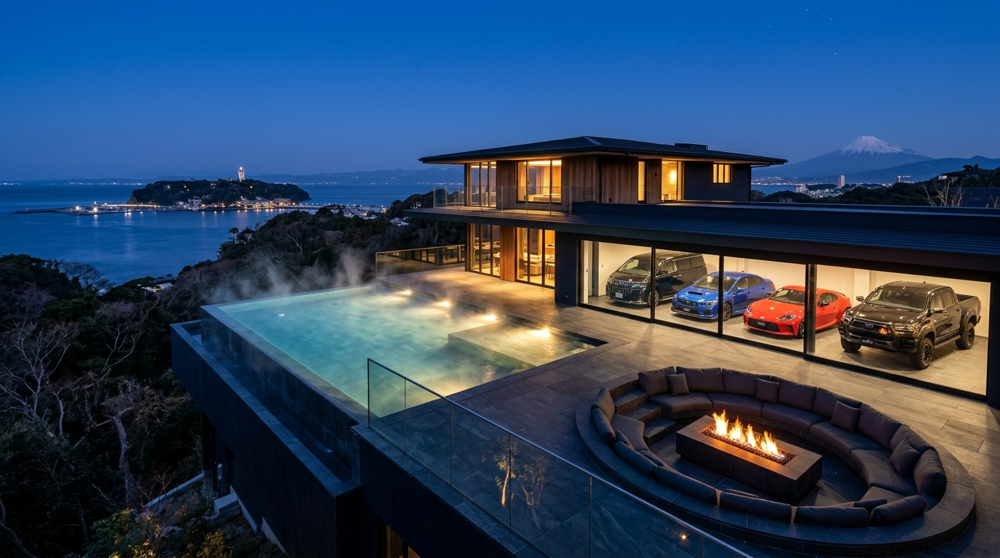
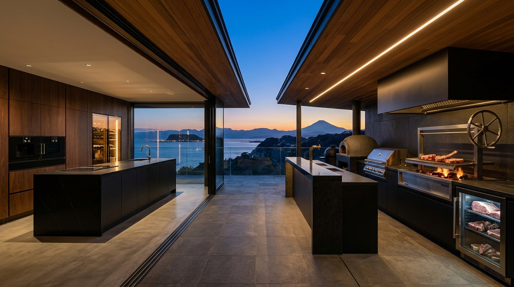
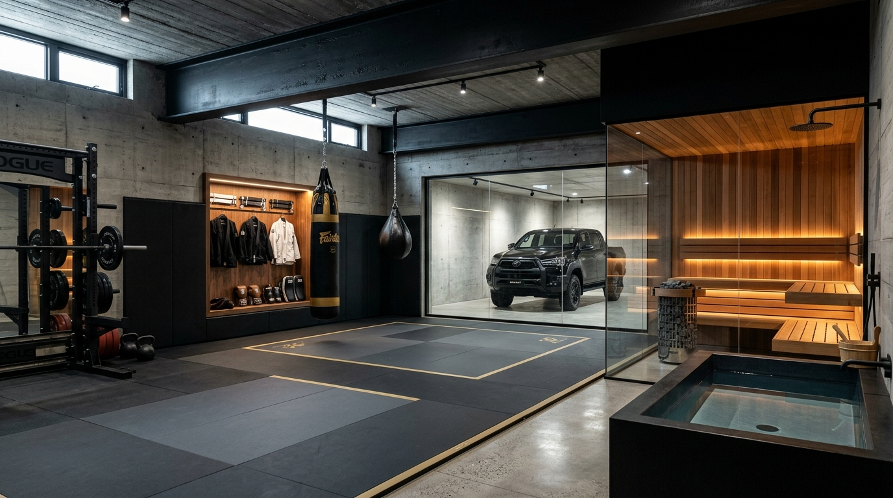
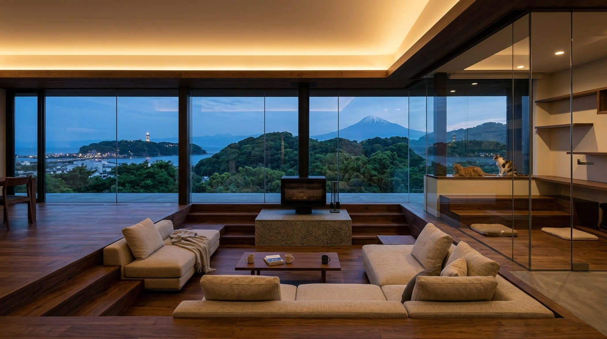
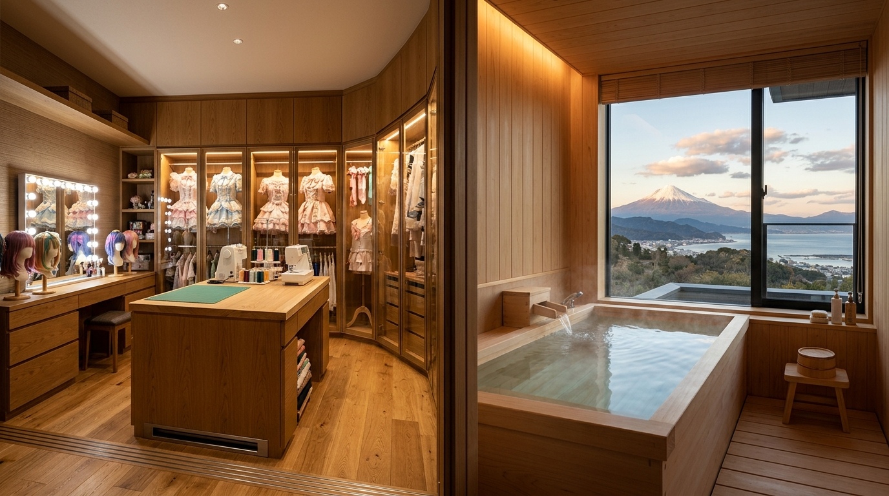

# 🏛️ VILLA AYAME — KAMAKURAYAMA (鎌倉山二丁目邸)
### **SHAWOOD × Sumitomo Forestry Big Frame (`BF-K構法`) — Luxury Architectural Showcase, 3D Digital Twin & Full CAD Blueprints**

🌐 **Live Architectural Website (GitHub Pages):** [**https://denkoboy185.github.io/villa-ayame-kamakurayama/**](https://denkoboy185.github.io/villa-ayame-kamakurayama/)

---

---

## 🔥🥩 1. Santuario Interior-Exterior: Mega Parrilla Wagyu BBQ & Cocina Chef Custom (`80.0 cm`)

- **Mega Parrilla Exterior (`4.50 m` sobre el *Sky-Deck* de Basalto frente al Monte Fuji):**
  - **Asador Argentino *Santa María* con Volante de Elevación en Acero Inoxidable (`アルゼンチン式薪・備長炭グリル`):** Leña de roble y carbón japonés *Kishu Binchotan* bajo **campana extractora industrial negra mate** (0% humo hacia **あやめ**).
  - **Cava Maduradora *Dry-Ager* de Wagyu A5 Empotrada (`熟成肉セラー`):** Control de humedad para cortes Tomahawk y Ribeye de *Kuroge Wagyu A5*.
  - **Grill Híbrido Profesional *Kalamazoo / Lynx* a Gas Ciudad (`980°C`) + Horno de Piedra para Pizzas (`450°C`) + Kamado Smoker.**
  - **Barra de Granito Negro con Grifo de Cerveza de Barril Helada (`生ビールサーバー`) y Mesa *Yakiniku* Sin Humo (`無煙焼肉テーブル`).**
- **Cocina Chef Interior Custom a `80.0 cm` de Altura (`153 cm ÷ 2 + 3.5 cm = 80.0 cm` para あやめ):**
  - Ebanistería en nogal negro americano de **Sumitomo Forestry**, isla monolítica de `3.20 m` en cuarzo negro *Marquina*, hornos **Gaggenau Serie 400**, alacenas motorizadas *Auto-Move* y **cava climatizada retroiluminada de vinos y sake**.

---

## 🥋🥊 2. Dojo Subterráneo de BJJ & Muay Thai (`20.50 m²`) + Sauna Finlandés Löyly `95°C` & Cold Plunge `15°C` (`7.50 m²`)

- **Tatami Profesional de Grappling `50 mm` (`Zebra / Dollamur`) + Muros Acolchados (`壁面クッション`):** Anclado sobre la losa de concreto armado `RC` de `300 mm` y roca madre de Kamakurayama (`N ≥ 50`) para proyectar derribos (*Double Leg*, *Uchi-mata*) o patear a plena potencia a las 2:00 AM con **0% de vibración estructural (`< 25 dB`)** hacia el dormitorio del `2F`.
- **Arsenal de Striking Muay Thai & S&C:** Saco banana pesado **Fairtex de `6 ft` (`180 cm`)** para *low kicks* y rodillas, saco *teardrop* de *clinch*, vitrina en nogal con sanitizador **UV-C** para Gis de BJJ, cinturones, guantes de `16 oz` y *Thai pads*, más **Power Rack Rogue** con barra olímpica, *kettlebells* y ventana acústica hacia la **Toyota Hilux GR Sport Negra (`#218`)**.
- **Sauna Finlandés *Self-Löyly* (`95°C–105°C`) & Cold Plunge (`15°C 水風呂`):** Calefactor **Harvia Cilindro `9.0 kW` (`200V`)** con piedras volcánicas, ducha de lluvia antibacterial post-tatami y tina de basalto negro con *chiller* dedicado a `15°C`.

---

## 🛋️🐱 3. Salón Hundido «Gorogoro», Solárium de Gatos Senior (+10 Años), Atelier Idol (*iLiFE!*) y Onsen *Hinoki* PDLC
| Salón Hundido «Gorogoro» (`-35 cm`) & Solárium Gatos Senior | Atelier Secreto de Pelucas (Aspiración en Zócalo) & Onsen *Hinoki* |
| :---: | :---: |
|  |  |

---

## 📐 4. Juego Completo de 6 Planos Ejecutivos CAD (`Escala 1:50 / 1:20`)
1. [**HOJA 01/06 — Emplazamiento Topográfico (`505.44 m²`) y Corte Estructural Sísmico (`18 Pilotes a Roca Madre`)**](cad/plano_01_emplazamiento_y_seccion.png)
2. [**HOJA 02/06 — Planta B1F (`176.00 m²`): Garaje 4 Autos (Hilux GR Sport NEGRA `#218`), Estudio `-55 dB`, Dojo BJJ/Muay Thai y Sauna `95°C`**](cad/plano_02_planta_b1f_garaje_y_bunker.png)
3. [**HOJA 03/06 — Planta 1F (`198.00 m² + 127.00 m² Terrazas`): Piscina Infinita `38°C`, Fogatero, Mega Parrilla Wagyu BBQ, Cocina `80cm`, Solárium Gatos y Suite *Hanare* `Dr-45`**](cad/plano_03_planta_1f_vida_y_skydeck.png)
4. [**HOJA 04/06 — Planta 2F (`154.00 m² + 22.00 m² Balcón`): Master Suite, Atelier de Pelucas/Idol, Onsen *Hinoki* PDLC + Kanta-kun y 4 Habitaciones de Hijos**](cad/plano_04_planta_2f_santuario_familiar.png)
5. [**HOJA 05/06 — Ingeniería MEP: Presión Positiva Hospitalaria HEPA (`+15 Pa` Anti-Insectos), Climatización Piscina `38°C`, Piso Radiante y Aspiración Central**](cad/plano_05_instalaciones_mep_y_acustica.png)
6. [**HOJA 06/06 — Detalles Constructivos (`1:20`): Rampa Láser `7°` (GR86 + Hilux Negra), Ergonomía Cocina `80cm`, Corte Piscina y Óptica Anti-Miradas Onsen**](cad/plano_06_detalles_constructivos_custom.png)

---

## 🧊 5. Archivos Nativos 3D (Blender 5.0 Cycles & glTF 2.0)
- 📦 [**Maqueta 3D Nativa Blender 5.0 (`models/Villa_Ayame_Kamakurayama_Maqueta_3D.blend`)**](models/Villa_Ayame_Kamakurayama_Maqueta_3D.blend)
- 🌐 [**Modelo 3D Universal glTF 2.0 (`models/Villa_Ayame_Kamakurayama_Maqueta_3D.glb`)**](models/Villa_Ayame_Kamakurayama_Maqueta_3D.glb)

---

## 💰 6. Presupuesto Ejecutivo Llave en Mano (`¥ JPY` / `$ USD`)
| Partida | Monto en Yenes (¥ JPY) | Monto en Dólares ($ USD) |
| :--- | ---: | ---: |
| **1. Terreno Real en Kamakurayama 2-Chome (`505.44 m²` / `152.89坪`, `SUUMO nc_20993255`)** | `¥190,000,000 JPY` | `$1,266,660 USD` |
| **2. Demolición de Casa Existente (1997) y Preparación de Roca Madre** | `¥6,500,000 JPY` | `$43,330 USD` |
| **3. Búnker Sísmico B1F en Concreto Armado (`RC造` — `176.00 m²` + 18 Pilotes + Estudio `Dr-55`)** | `¥58,000,000 JPY` | `$386,660 USD` |
| **4. Mansión Custom Sumitomo Forestry *Big Frame* (`1F + 2F` — `352.00 m²`)** | `¥145,000,000 JPY` | `$966,660 USD` |
| **5. Sky-Deck de Basalto (`85.00 m²`), Fogatero Sin Humo, Ascensor 3 Paradas y Solar `12 kW`** | `¥22,000,000 JPY` | `$146,660 USD` |
| **6. Piscina Infinita Climatizada Sísmica (`8.50m × 2.80m` a `38°C` en Acero Inoxidable)** | `¥18,500,000 JPY` | `$123,330 USD` |
| **7. Dojo Subterráneo BJJ & Muay Thai (`20.50 m²`) + Sauna Finlandés `95°C` & Cold Plunge `15°C` (`7.50 m²`)** | `¥8,500,000 JPY` | `$56,660 USD` |
| **8. Mega Parrilla Wagyu BBQ (`4.50 m`: Santa María + Kalamazoo + Cava Wagyu + Horno `450°C`)** | `¥6,500,000 JPY` | `$43,330 USD` |
| **9. Impuestos, Registro Inmobiliario y Licencias de Kamakura (~7%)** | `¥24,500,000 JPY` | `$163,330 USD` |
| **10. Flota de 4 Vehículos JDM (Vellfire Negro + WRX S4 Azul + GR86 Rojo + Hilux GR Sport NEGRA `#218`)** | `¥21,060,000 JPY` | `$140,400 USD` |
| **🏆 TOTAL PROYECTO COMPLETO LLAVE EN MANO** | **`¥500,560,000 JPY`** | **`$3,337,030 USD`** |
